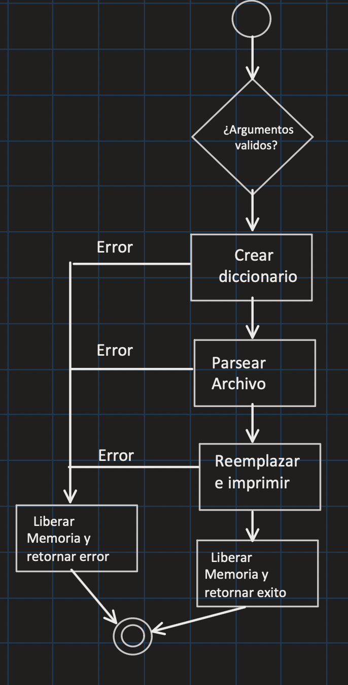
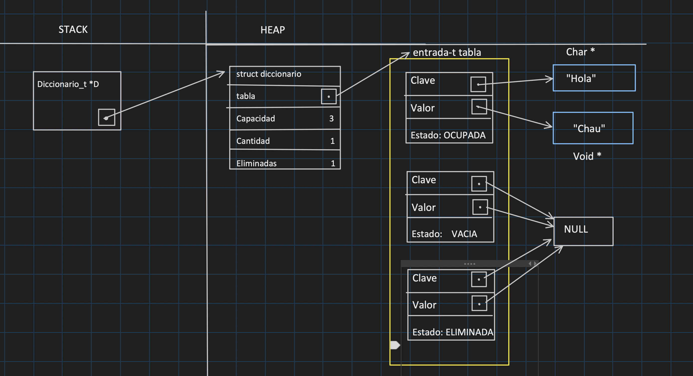

<div align="right">
    
</div>

# TP

## Información del estudiante

* Nicolas Martinez
* 115882
* nmartinez@fi.uba.ar
* Nicomartinez07
---


## Índice
* [1. Instrucciones](#1-Instrucciones)
  * [1.1. Compilar el proyecto](#11-Compilar-el-proyecto)
  * [1.2. Ejecutar las pruebas](#12-Ejecutar-las-pruebas)
  * [1.3. Ejecutar el programa con Valgrind](#13-Ejecutar-el-programa-con-Valgrind)
  * [1.4. Ejecutar las pruebas con Valgrind](#13-Ejecutar-las-pruebas-con-Valgrind)
* [2. Funcionamiento](#2-Funcionamiento)
* [3. Estructura](#3-Estructura)
  * [3.1. Diagrama de memoria](#31-Diagrama-de-memoria)
  * [3.2. Análisis de complejidades](#32-Análisis-de-complejidades)
* [4. Decisiones de diseño y/o complejidades de implementación](#4-Decisiones-de-diseño-yo-complejidades-de-implementación)
* [5. Respuestas a las preguntas teóricas](#5-Respuestas-a-las-preguntas-teóricas)

## 1. Instrucciones

### 1.1. Compilar el proyecto
```bash
make
```

### 1.2. Ejecutar las pruebas
```bash
make pruebas
```

### 1.3. Ejecutar el programa con Valgrind
```bash
make valgrind_main
```

### 1.4. Ejecutar las pruebas con Valgrind
```bash
make valgrind_alumno
```

## 2. Funcionamiento 
El programa recibe un archivo el cual funciona como un diccionario, y un texto a modificar. Para esto primero, procesa el archivo, vuelca su contenido en un diccionario parseando sus lineas. Y posteriormente procede a reescribir el texto ingresado por el usuario reemplazando las palabras que esten contenidas como claves en el diccionario por sus valores asociados. Una vez finalizado el proceso de reescribir, se encuentra por salida estandar, el resultado de la operacion. Para finalizar realiza una liberacion de toda la memoria solicitada durante la ejecucion del programa

<div align="center">
  
  <p>Diagrama de flujo del programa.</p>
</div>

## 3. Estructura 
Para implementar el diccionario solicitado, decidi implementar un vector dinamico de entrada_t. Cada campo de esta estructura contiene un par clave-valor , y un campo estado el cual indica si una posicion esta eliminada/ocupada/vacia. Este ultimo campo me brinda la posibilidad de simplificar el proceso de busqueda y eliminacion de los elementos del diccionario. A su vez ademas del vector hay un size_t el cual indica el tope del vector, otro el cual indica la capacidad maxima del vector y por ultimo un campo eliminadas el cual indica la cantidad de posiciones cuyo par fue eliminado.

### 3.1 Diagrama de memoria 
<div align="center">
  
  <p>Diagrama de memoria del diccionario con un unico par clave-valor ingresado.</p>
</div>

### 3.2. Análisis de complejidades 

* `diccionario_crear` tiene una complejidad de $O(1)$ debido a que unicamente se realizan instrucciones simple de solicitud de memoria y asignacion de variables.
* `diccionario_insertar` tiene una complejidad de $O(1)$ en el mejor de los casos, que seria si el valor a ingresar ya se encontraba en la tabla, y al calcularle el indice y buscarlo, se encuentra en ese indice. Pero en cambio si no se encuentra en la tabla y recorre todos los elementos para encontrarlo. Se debe redimensionar la tabla rehashenado, lo cual implica un volcado de todos los pares con estado OCUPADO. O si se recorre toda la tabla y no se encuentra alguna posicion disponible para insertar, el costo de la funcion pasa a ser $O(n)$. Si se cumple alguna de estas ultimas tres condiciones en conjunto, se sumarian las complejidades y el costo seria aun mayor.
* `diccionario_buscar` tiene una complejidad de $O(n)$ en el peor de los casos, que es cuando la clave no se encuentra en la tabla, por ende recorre todos los elementos buscando si esta para retornar. En cambio en el mejor de los casos, que es cuando la clave esta en el indice indicado por la funcion de hash, tiene una complejidad $O(1)$ debido a que simplemente se retorna que esta contenida en la tabla.
* `diccionario_obtener` tiene una complejidad de $O(n)$ en el peor de los casos, que es cuando la clave no se encuentra en la tabla, por ende recorre todos los elementos buscando si esta para obtener el valor asociado y retornarlo. En cambio en el mejor de los casos, que es cuando la clave esta en el indice indicado por la funcion de hash, tiene una complejidad $O(1)$ debido a que simplemente obtiene el valor asociado a esa clave y lo retorna.
* `diccionario_eliminar` tiene una complejidad de $O(n)$ en el peor de los casos, que es cuando la clave no se encuentra en la tabla, por ende recorre todos los elementos buscando si esta. En cambio en el mejor de los casos, que es cuando la clave esta en el indice indicado por la funcion de hash, tiene una complejidad $O(1)$
* `diccionario_cantidad` tiene una complejidad de $O(1)$ ya que unicamente se retorna un dato contenido en el diccionario.
* `diccionario_iterar` tiene una complejidad de $O(n)$ en el peor de los casos, debido a que si se invoca una funcion en la cual todos los elementos devuelven true, tiene que recorrer N cantidad de elementos contenidos
* `diccionario_destruir` tiene una complejidad de $O(n)$ siendo N la cantidad de elementos con un estado OCUPADO. Debido a que tiene que iterar por cada uno para liberar la clave. 
* `diccionario_destruir_todo` tiene una complejidad de $O(n)$ siendo N la cantidad de elementos con un estado OCUPADO. Debido a que tiene que iterar por cada uno para liberar la clave y ademas aplicarle la funcion destructor a el valor de esa clave. 

* `rehash` tiene una complejidad de $O(n)$ debido a que en el proceso de redimensionar a una nueva tabla, realiza un recorrido por todos los elementos con estado OCUPADO de la tabla anterior para volcarlos a la nueva tabla. 
* `buscar_posicion` tiene una complejidad $O(n)$ en el peor caso, debido a que puede recorrer toda la tabla y no encontrar un lugar vacio, si es el caso en el que se busca un lugar disponible. O puede recorrer todas la tabla sin encontrar la clave buscada.


## 4. Decisiones de diseño y/o complejidades de implementación
La principal decision de diseño que tome fue el hecho de incorporar un enum estado el cual funcione como un aviso para identificar de manera sencilla si una posicion esta o no disponible para utilizar. Esto me ayuda principalmente al momento de operar con el diccionario debido a que puedo evitar que al eliminar un elemento del diccionario se rompa la cadena de colisiones y no tener que reacomodar en cada borrado el diccionario completo.

Con la estructura interna elegida para implementar el diccionario pedido, la principal complejidad reside en el proceso de insercion. 
Debido que primero hay que verificar si el par a insertar no se encuentra previamente en el diccionario. Si se encuentra simplemente realizamos un reemplazo del valor asociado y terminamos el proceso ejecutando el mejor caso posible. Pero en el caso de que no se encuentre actualmente en el diccionario, hay que realizar una copia de la clave para no modificar la original, realizar un rehash en el caso de que el factor de carga haya superado el limite establecido, y posteriormente el proceso de encontrar una posicion disponible para realizar la insercion del nuevo par. El hecho de modularizar la funcion en diferentes subfunciones me ayudo a desarrollar y a desarrollar de una manera mucho mas sencilla el flujo de insercion.


## 5. Respuestas a las preguntas teóricas

### 5.1. Qué es un diccionario
Un diccionario es un TDA que almacena pares clave-valor. Una de las caracteristicas principales es que cada clave es unica y esta asociada a un valor. La estructura principalmente nos da la posibilidad de buscar un valor simplemente ingresando su clave asociada. Esto puede reducir mucho el costo de una operacion de busqueda en un conjunto de datos.

### 5.1.1 Explica 3 formas diferentes de implementar un diccionario
1era forma (Vector): Podriamos tomar un vector como diccionario en el cual el indice numerico del vector se podria interpretar como una clave unica y el dato almacenado en esa posicion del vector, se puede interpretar como el valor asociado a esa clave.

2da forma (Tabla Hash): Necesitamos utilizar una funcion de hash la cual tiene que transformar una clave de cualquier tipo de dato en un indice dentro de la tabla de hash. Al querer almacenar los valores en las posiciones obtenidas, tenemos que decidir que tipo de Hash estamos utilizando para evitar colisones.

En el caso de que el hash sea abierto, hay una lista asociada por cada posicion de la tabla, por ende se pueden almacenar tantos elementos como cada lista asociada a la posicion de la tabla lo permita. En cambio en el hash cerrado, en el caso de que dos claves den el mismo indice numerico hay que buscar una posicion libre utilizando por ejemplo, probing lineal. 

3era forma (Arboles): Necesitamos un arbol binario de busqueda balanceado el cual contenga los pares en nodos ordenados segun sus claves. Cada nodo padre, contiene 2 hijos los cuales representan un nuevo par clave-valor. 

### 5.2 Qué es una función de hash y qué características debe tener para nuestro problema en particular
Una funcion hash es una funcion la cual se encarga de transformar las claves en un numero asociado, de manera tal que al ingresarle distintas claves, nos indica a que indice del conjunto de datos corresponde. Para nuestro problema en particular tiene que ser capaz de transformar claves de texto (strings) en numeros asociados a ese string. Ademas de eso tiene que ser deterministica, es decir, para una misma clave dada, tiene que devolver siempre el mismo indice resultante.

### 5.3 Qué es una tabla de Hash y los diferentes métodos de resolución de colisiones vistos 
Una tabla de hash es una estructura que contiene valores, la misma me permite hallar esos valores a partir de una clave mediante el resultado de una funcion de hash. Esta tabla puede ser de dos formas distintas:

Abierta: Cada elemento de su tabla es una lista enlazada la cual contiene todos los elementos cuyo resultado de la funcion de hash comparten ese indice exacto. Un metodo de resolver las colisiones en mediante encadenamiento, este resulta ser la caracteristica principal de la tabla ya que consiste en asociar cada indice de la tabla a una estructura de datos externa. Cuando 2 claves generan el mismo indice como resultado de la funcion de hash, ambos se insertan como elementos de esa estructura de datos externa.

Cerrada:  Cada elemento de la tabla puede ser ocupado unicamente por un conjunto de clave-valor, por ende, si dos o mas claves resultan en un mismo indice, una sola puede ocuparlo, por lo tanto se utiliza probing lineal. Este mecanismo se trata de seguir recorriendo la tabla hasta encontrar una posicion que no este ocupada por otro elemento. Ademas del probing lineal tambien existe el Hash Doble y el probing cuadratico. El hash doble consiste en aplicar una segunda funcion de hash a la clave cuando se genero una colision. En cambio el probing cuadratico consta de hacer el incremento del intento de manera cuadratica, 

### 5.4 Por qué es importante el tamaño de la tabla 
El tamaño de la tabla es un factor importante a considerar debido que es lo que nos indica cuantos distintos elementos pueden ser almacenados en la tabla, principalmente en la tabla cerrada, es un limitante debido a que uno nunca va a poder insertar mas elementos que la capacidad permitida. Si ese fuera el caso, el factor de carga (relacion de cantidad de elementos almacenados con el tamaño de la tabla) estaria superado y habria que realizar un proceso de rehash el cual se encarga de redimensionar la tabla y cargar nuevamente cada conjunto en el lugar correspondiente.

### 5.4.1 Dado que en una tabla abierta se pueden encadenar colisiones sin importar el tamaño de la tabla, ¿Realmente importa el tamaño?

Si el tamaño en una tabla abierta sigue siendo importante ya que determina cuantas listas asociadas distintas puede haber. Esto conlleva a que mientras mas distribucion de los elementos haya, menor va a ser la complejidad al momento de buscarlos en el diccionario. Debido a que si se cuenta con una cantidad reducida de elementos (3 por ejemplo) es muy dificil de evitar que las listas se llenen de informacion y si queremos obtener un dato particular interior a la lista voy a tener que recorrer probablemente la mayoria de la lista.

